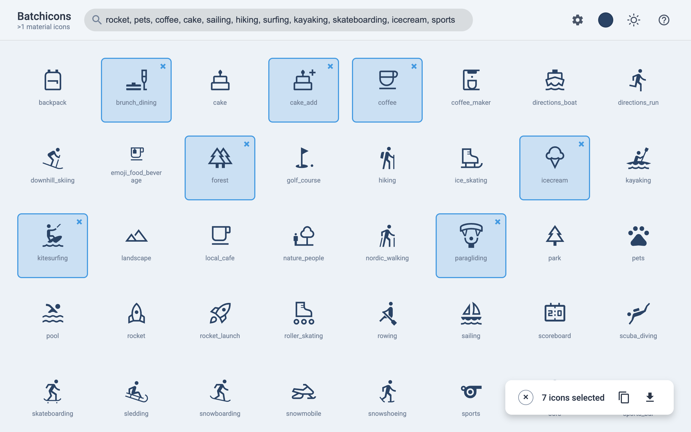
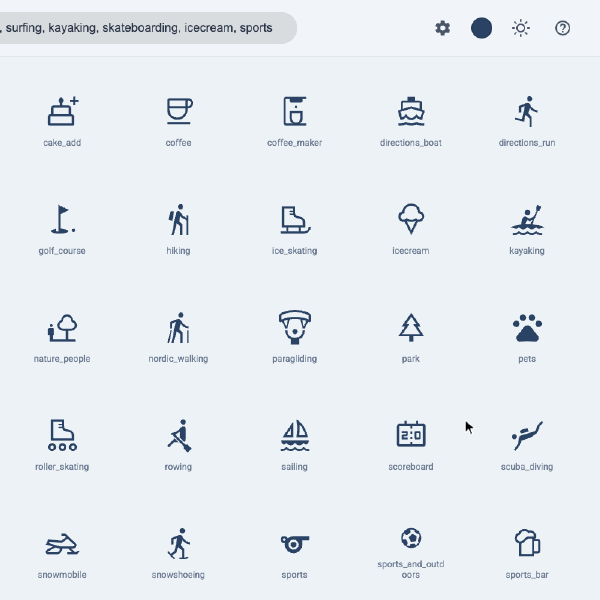
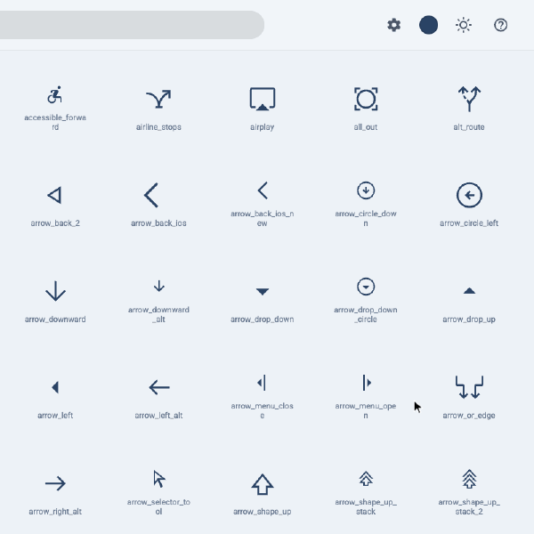
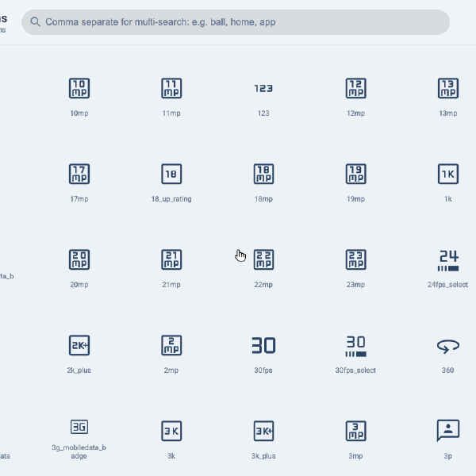
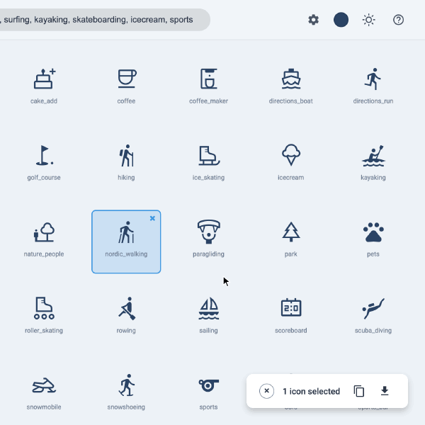

# `batchicons`

One-click bulk SVG icon search and download. Pick a whole set of Material icons in a few clicks and take them all with you: one copy for every SVG, or one download as a zip.

  
[<kbd> haaans.com/batchicons  </kbd>](https://haaans.com/batchicons/?search=rocket%2C%20pets%2C%20coffee%2C%20cake%2C%20sailing%2C%20hiking%2C%20surfing%2C%20kayaking%2C%20skateboarding%2C%20icecream%2C%20sports)

## Features

<table>
<tr valign="top">
<td width="50%">
<h3>Icon cart that follows you around</h3>
</td>
<td width="50%">

</td>
</tr>
<tr valign="top">
<td width="50%">

</td>
<td width="50%">
<h3>Basic utilities, like shift + click</h3>
</td>
</tr>
<tr valign="top">
<td width="50%">
<h3>Comma-driven multi-search</h3>
</td>
<td width="50%">

</td>
</tr>
<tr valign="top">
<td width="50%">

</td>
<td width="50%">
<h3>Quick styles</h3>
</td>
</tr>
</table>
