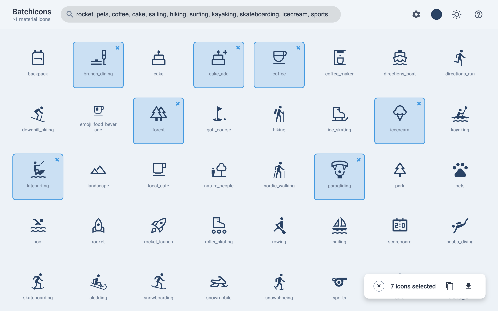
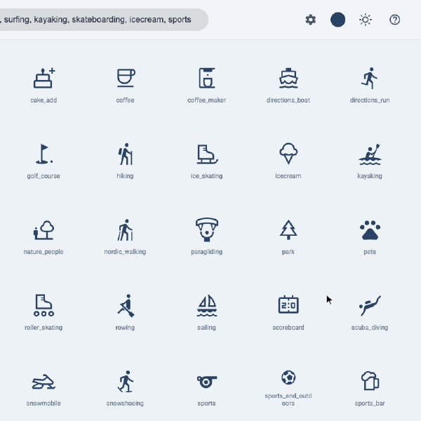
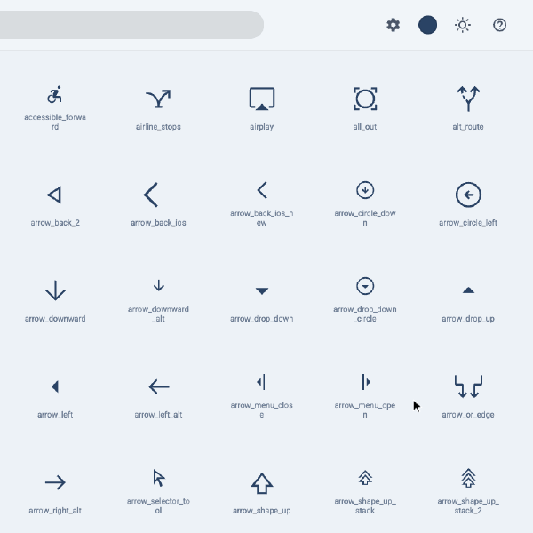
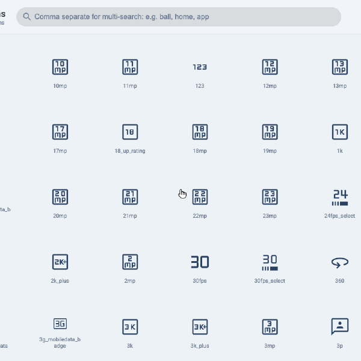
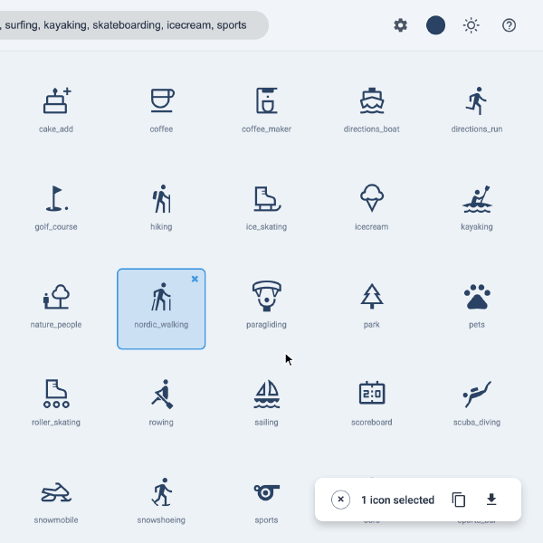
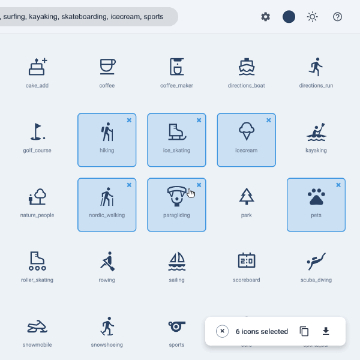

# `batchicons`

Pick a whole set of Material icons in a few clicks and take them all with you: one copy for every SVG, or one download as a zip.

  
[<kbd> haaans.com/batchicons  </kbd>](https://haaans.com/batchicons/?search=rocket%2C%20pets%2C%20coffee%2C%20cake%2C%20sailing%2C%20hiking%2C%20surfing%2C%20kayaking%2C%20skateboarding%2C%20icecream%2C%20sports)

## Features

<table>
<tr valign="top">
<td width="50%">
<h3>Click to collect</h3>

Every click adds an icon to your set, and the counter keeps a running total. Click again or hit the × to drop one.

</td>
<td width="50%">

</td>
</tr>
<tr valign="top">
<td width="50%">

</td>
<td width="50%">
<h3>Shift-click a whole range</h3>

Click one icon, then shift-click another, and everything in between joins the set at once.

</td>
</tr>
<tr valign="top">
<td width="50%">
<h3>Search for several at once</h3>

Separate terms with commas to see them all in one grid. Your picks stay selected from search to search, so you can build a set from anywhere.

</td>
<td width="50%">

</td>
</tr>
<tr valign="top">
<td width="50%">

</td>
<td width="50%">
<h3>Set the style for the whole batch</h3>

Switch to filled icons, change the weight or the optical size, or pick a color. Every icon changes together, and that's the version you export.

</td>
</tr>
<tr valign="top">
<td width="50%">
<h3>Copy or download them all</h3>

One click copies every selected SVG, and one more downloads them as a single zip. With the keyboard it's <kbd>c</kbd> or <kbd>d</kbd>.

</td>
<td width="50%">

</td>
</tr>
</table>
